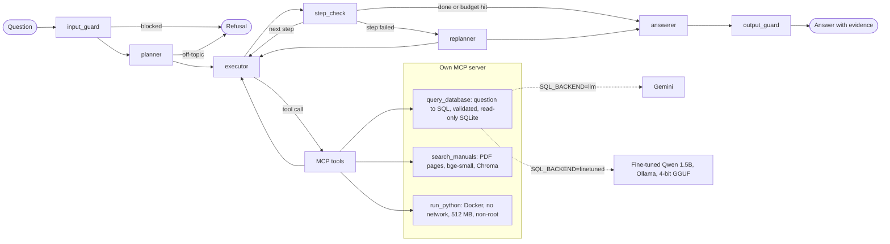

# Industrial Data Analyst Agent

An agent that answers questions about an industrial machine fleet (27 machines, 60 days of sensor readings, alarms and maintenance) by combining **SQL over a sensor database**, **search over machine manuals** and **Python analysis in a sandbox**. The SQL can come from a **1.5B model I fine-tuned** (QLoRA, served locally by Ollama) or from Gemini; a 37-task eval shows both reach the same success rate inside the agent.

**Headline numbers**
- Fine-tuning Qwen2.5-Coder-1.5B raised Text-to-SQL execution accuracy from **28.7% to 64.3%** on 129 held-out questions (Gemini flash-lite: 76.7%).
- The full agent passes **36/37** eval tasks with Gemini writing the SQL and **35/37** with the fine-tuned local model, after two measured rounds of prompt changes (baseline 34 and 33).
- Built for **$0**: free-tier Gemini with per-role model pools and a quota memory, a free Colab T4 for training, and local inference.

<!-- Demo GIF: docs/demo.gif (Streamlit UI answering a SQL + manual + plot question) -->

## Architecture



- **Agent**: LangGraph planner/executor with a replanner and budgets (15 tool calls, 4 per step, 2 replans, 25 LLM calls). The executor works one plan step at a time.
- **Tools**: one MCP server the agent reaches through `langchain-mcp-adapters`. `query_database` takes natural language, not SQL, so the fine-tuned model does the SQL work. Large query results stay on the server as datasets that `run_python` mounts read-only, so they never pass through the LLM context.
- **Guardrails**: an input guard that blocks write and injection requests with 0 LLM calls, an SQL AST allow-list on a read-only connection, every tool result wrapped as `<untrusted_data>`, the Docker sandbox, and an output guard that flags numbers not found in any tool result.
- **Observability**: Langfuse traces each question with nested spans for nodes, LLM calls (tokens, cost) and tool calls.
- **UI**: Streamlit chat that streams each agent step, the SQL, manual citations and plots.

Full interfaces and the decision log: [docs/design.md](docs/design.md).

## Example questions
- "Which compressor had the most critical alarms in September, and what does the manual recommend for that alarm?"
- "Plot the spindle temperature of CNC-Mill-03 around its last HIGH_HIGH alarm."
- "What was the total corrective maintenance cost per plant, and which machine type drives it?"

## Results

**Text-to-SQL on its own** (`eval/eval_sql.py`, 129 held-out test questions; a question counts as right when the query returns the same rows as the gold SQL):

| Model | Execution accuracy |
|---|---|
| Qwen2.5-Coder-1.5B, base | 28.7% |
| Qwen2.5-Coder-1.5B, QLoRA fine-tuned (served by Ollama, 4-bit GGUF) | 64.3% |
| gemini-3.1-flash-lite | 76.7% (upper estimate: Gemini models wrote the gold SQL) |

**Manual search** (`eval/eval_retrieval.py`, 17 queries): recall@1 0.88, recall@3 0.94, MRR 0.91.

**The whole agent** (`eval/run_eval.py`, 37 tasks in `eval/tasks.yaml`, checked without an LLM judge). Both backends ran each task back to back on the same free-tier Gemini planner and executor models; only the model that writes the SQL differs:

| | Gemini writes SQL | Fine-tuned Qwen writes SQL |
|---|---|---|
| **Tasks passed** | **34/37 (92%)** | **33/37 (89%)** |
| sql_only (13) | 11 | 12 |
| manual_only (6) | 6 | 6 |
| sql+manual (6) | 5 | 5 |
| sql+python (5) | 5 | 5 |
| multi_hop (3) | 3 | 1 |
| should_refuse (4) | 4 | 4 |
| Avg tool calls / LLM calls per task | 1.6 / 4.8 | 2.1 / 5.5 |
| Avg latency | 23 s | 40 s |
| Gemini calls for SQL | 1 per query | 0 (local) |

Inside the agent, the 1.5B local model is level with Gemini: a 1-task gap on 37 tasks is noise. It writes worse SQL on its own (64% vs 77%), but the planner and executor catch part of that with retries, which is why its runs take more tool calls and longer. Both backends fail the same planted trap: when 5 machines tie for "top 3", they answer with `LIMIT 3` and name only 3. Every failed task was read by hand. Details: [`eval/results/baseline/report.md`](eval/results/baseline/report.md) and the decision log in [docs/design.md](docs/design.md).

**Prompt changes, measured** (same 37 tasks, each change as a new run against the baseline). The SQL prompt never changed, because it is the fine-tuned model's training format; only the planner, executor and answerer prompts did.

| | Gemini writes SQL | Fine-tuned Qwen writes SQL |
|---|---|---|
| baseline | 34/37 | 33/37 |
| `prompts_v1`: names not IDs, full rankings instead of `LIMIT` (ties), separate questions per table | 36/37 | 33/37 (4 fixed, 4 broken) |
| **`prompts_v2`**: plain-word questions, sensor types, aggregates in the database, 60-day rates | **36/37** | **35/37** |
| avg latency in v2 | 19 s | 19 s |

v1 helped the Gemini backend but not the fine-tuned one: its more detailed questions ("ask for sensor names and the filtered columns") made the 1.5B model invent a `sensor_name` column and drop filters. v2 asks in plain words instead, and the fine-tuned backend fixed all 4 of those. Both ties are now answered in full on both backends.

Still failing in v2: both backends answer "which presses had a HIGH_HIGH oil-temperature alarm" (true answer: none) with presses whose HIGH_HIGH alarms were on other sensors, after the exact query correctly returned no rows; and the fine-tuned model once dropped the machine column from a per-pump query, so the chart step ran out of tool calls. Each task ran once per config, so a 1-2 task difference is close to noise. Reports: [`baseline`](eval/results/baseline/report.md), [`prompts_v1`](eval/results/prompts_v1/report.md), [`prompts_v2`](eval/results/prompts_v2/report.md).

## Design decisions
Each of these came from a failure seen while building; the [decision log](docs/design.md#6-decision-log-findings-while-building) has the details.

- **Training data checked by execution, then by reading results.** Gemini wrote about 1,500 question/SQL pairs; each one had to run and return a non-trivial result. A hand review then found that `ORDER BY ... LIMIT 1` hides ties, which no SQL reading catches, so the checker reruns each query to detect ties, mixed units (ranking rpm against °C) and bare columns beside `MAX()`.
- **No leakage between train and test.** The split hashes the SQL shape, and a fingerprint of tables, literals and result rows removed 9 test questions that repeated a training query with the joins in another order.
- **Deterministic eval, no LLM judge.** Each task has a reference SQL, a number, required manual pages or "must refuse". Both SQL backends run each task back to back so they see the same rotated Gemini models. Every failure is read by hand before it is reported.
- **Prompt changes measured, not assumed.** A rule that helped Gemini ("ask for sensor names and the filtered columns") broke 4 tasks for the 1.5B model, which invented a `sensor_name` column. For a weak SQL model, the executor has to ask simpler questions, not more precise ones. The SQL prompt never changed, because it is the fine-tuned model's training format.
- **Free tier as a design constraint.** Per-role model pools with a file-based quota memory skip models until their reset time and back off exponentially on server errors, so a run moves to the next model instead of failing.

## Limitations
- The data and manuals are synthetic, and Gemini models wrote the gold SQL, so Gemini's 76.7% is an upper estimate.
- 37 tasks, each run once per config: a difference of 1-2 tasks is noise.
- When the exact query correctly returns no rows, the agent can widen it and report the wider rows as matches (the HIGH_HIGH oil-temperature task fails this way on both backends).
- `output_guard` catches invented numbers, not wrongly summarised ones or wrong claims.
- The fine-tuned model's remaining SQL errors are mostly invented column names; it is weak on window functions, thresholds and time windows.
- The training pairs were written with Gemini, whose terms limit developing competing models, so the dataset and the trained model are not published.

## Setup
Requires Python ≥ 3.11 and Docker (for `run_python`).

```bash
py -3.12 -m venv .venv            # or: python3.12 -m venv .venv
.venv\Scripts\activate            # Linux/macOS: source .venv/bin/activate
pip install -e ".[all]"           # extras: rag, sandbox, obs, ui, dev
pytest
```

## Try it
```bash
python -m ida.agent.run "Which pump had the most critical alarms and what does the manual say?"
python -m ida.agent.run --demo                              # 5 sample questions, step by step
streamlit run src/ida/ui/app.py                              # chat UI with live agent steps
python data/generate_db.py --out data/sensors.db            # build the DB once
python -m ida.mcp_server.manuals_index                       # build the manual search index once
python -m ida.mcp_server.sandbox --build                     # build the run_python Docker image once
python scripts/try_mcp_tools.py                              # start MCP server, call both tools
python scripts/try_mcp_tools.py sql "Average spindle temperature per CNC mill last week"
python scripts/try_mcp_tools.py manuals "pump cavitation noise" Pump
python scripts/try_mcp_tools.py chain                        # SQL -> dataset -> sandboxed plot
python eval/eval_retrieval.py                                # retrieval recall@k / MRR
pytest            # unit tests (no API calls)
pytest --live     # also runs tests that call the LLM
```

## Data
`data/generate_db.py` builds a synthetic but internally consistent database: alarms are derived from readings and thresholds, and corrective maintenance is linked to critical alarms. It also contains deliberate SQL traps such as NULL readings, active alarms and a decommissioned machine.

```bash
python data/generate_db.py --out data/sensors.db --seed 42 --days 60
python data/build_manuals.py      # -> data/manuals/*.pdf (committed)
```

The manuals are synthetic. Their alarm thresholds come from the same profiles as the database, and they include troubleshooting tables, alarm-response procedures, maintenance intervals and part numbers.

The question→SQL pairs in `finetune/data/` were written by Gemini and checked by execution. They are for private learning: the terms of the Gemini API limit using it to develop competing models, so this dataset and any model trained on it are not published.

## Layout
```
data/            schema, DB generator, manual builder, manual PDFs
src/ida/
  mcp_server/    FastMCP server, query_database / search_manuals / run_python
  agent/         LangGraph graph, prompts, guardrails, tracing, CLI
  ui/            Streamlit app
  model_pool.py  per-role Gemini pools with quota memory
  training_data.py  question/SQL pair generation, checks, split
finetune/        Colab QLoRA notebook, Ollama Modelfile, data (private)
sandbox/         Dockerfile for run_python
eval/            tasks.yaml, harnesses, results per run
tests/           207 unit tests (no API calls); --live for LLM tests
```
